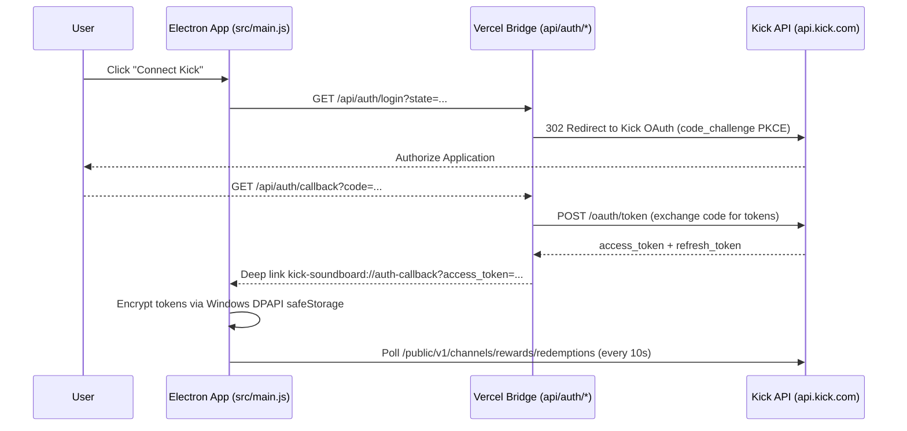

# Kick API Integration Skill

Use this skill when developing or debugging Kick Developer API communication, OAuth 2.1 authentication, token encryption, polling loops, or channel reward resolution.

## Core Architecture



## Key Modules & Patterns

1. **OAuth 2.1 PKCE Authorization & Deep Linking**:
   - Bridge endpoints: `api/auth/login.js`, `api/auth/callback.js`, `api/auth/refresh.js`.
   - Deep link schema: `kick-soundboard://auth-callback?access_token=...&refresh_token=...`.
   - Validated in `src/deep-link.js` (`parseAuthDeepLinkUrl`).

2. **Windows DPAPI `safeStorage` Encryption**:
   - In `src/main.js`, all access and refresh tokens are encrypted on disk using Electron's `safeStorage.encryptString(token)` before writing to `config.json`.
   - On startup, tokens are decrypted using `safeStorage.decryptString(buffer)`.
   - Plaintext tokens are never stored in settings or unencrypted files.

3. **Polling Engine with Jitter & Exponential Backoff (`src/polling-backoff.js`)**:
   - Normal interval: `10000ms` (10 seconds).
   - Upon HTTP 429 or 5xx: Back off exponentially up to 5 minutes (`300000ms`), respecting `Retry-After` HTTP headers when provided.
   - Jitter: Adds randomized jitter to avoid thundering herd against Kick API endpoints.

4. **FIFO Redemption Queue & Status Detection (`src/redemption-playback.js`)**:
   - Polls `/public/v1/channels/rewards/redemptions`.
   - Newly approved redemptions are enqueued oldest first (FIFO).
   - Prevents replaying already processed redemptions on reconnect or restart.
   - If `playPending: true`, triggers playback immediately when viewer submits redemption; otherwise waits for broadcaster approval.

5. **Batch User Resolver & Profile Cache (`src/user-resolver.js`)**:
   - Viewer IDs from redemptions are batched in groups of up to 50 (`chunkArray`).
   - Fetches viewer usernames via `/public/v1/users?id=...` and caches them in memory and local storage to minimize redundant API requests.

6. **Local Server Security (`src/main.js` & `src/js/api.js`)**:
   - Electron main process runs an internal HTTP server on a random localhost port (`127.0.0.1`).
   - Generates an ephemeral session token (`X-Kick-App-Token`) on launch.
   - Rejects non-localhost hosts (421 Misdirected Request) and unauthorized origins (403 Forbidden).

## Verification Workflow

Run the test suite verifying OAuth, polling backoff, redemption playback, and user resolver:
```powershell
pnpm test
```
Specific tests:
- `bridge login / callback / refresh`
- `deep-link URL parsing and rejection of invalid URLs`
- `local server security, origin checking, and session tokens`
- `polling backoff exponential delay and Retry-After parsing`
- `redemption playback FIFO ordering and approval detection`
- `batch username resolution and caching`
