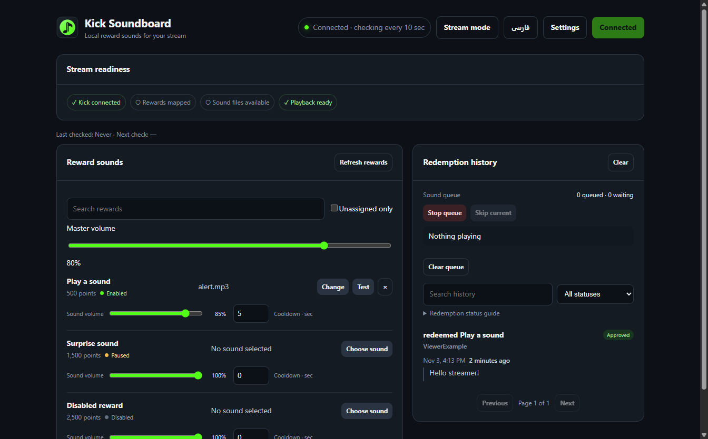
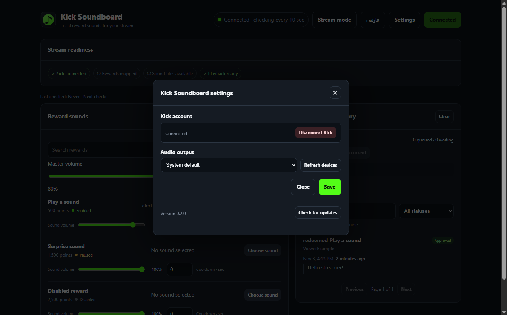

# Kick Soundboard

**1-Click Kick channel point rewards → audio playback on your Windows stream PC.**

Kick Soundboard is a local Windows desktop application that listens for approved Kick channel point reward redemptions and plays your assigned audio files in real time through your sound card into OBS.

[](https://github.com/MehdiMeidanshahi/Kick-Soundboard/releases)
[](https://github.com/MehdiMeidanshahi/Kick-Soundboard/releases/latest)
[](https://github.com/MehdiMeidanshahi/Kick-Soundboard)
[](LICENSE)

**Languages / زبان‌ها:** [English](#english) · [فارسی](#فارسی)  |  [GitHub Releases](https://github.com/MehdiMeidanshahi/Kick-Soundboard/releases)

---

## English

### Quick Navigation
- [⚡ Quick Install (For Streamers)](#-quick-install-for-streamers)
- [🎯 Channel Point Community Goal (OBS Overlay)](#-channel-point-community-goal-obs-overlay)
- [🎬 OBS Stream Alert Banner Overlay](#-obs-stream-alert-banner-overlay)
- [🎛️ Sound Pad & Stream Deck Hardware Integration](#-sound-pad--stream-deck-hardware-integration)
- [📸 Screenshots](#-screenshots)
- [🛠️ Detailed Setup (For Developers)](#️-detailed-setup-for-developers)
- [🔒 Privacy & Security](#-privacy--security)
- [⚙️ Technical Details](#️-technical-details)

---

### ⚡ Quick Install (For Streamers)

No developer app creation, manual Client ID/Secret entry, or localhost redirect setup is needed. You can connect your Kick account in 1 click!

#### 1. Download & Install
1. Go to the [**Latest GitHub Releases**](https://github.com/MehdiMeidanshahi/Kick-Soundboard/releases/latest).
2. Choose your preferred format:
   - **Standalone Portable (No install needed)**: Download **`Kick-Soundboard-Portable-0.3.2.exe`** and run it immediately from any folder or USB drive.
   - **Windows Installer**: Download **`Kick-Soundboard-Setup-0.3.2.exe`** for desktop and Start Menu shortcuts.
   - **Standalone Zip Package**: Download **`Kick-Soundboard-0.3.2-win-x64.zip`** if you prefer unzipping the folder manually.

> [!NOTE]
> As an independent open-source release without an expensive corporate code-signing certificate, Windows SmartScreen may show an *"Unknown publisher"* prompt on first launch. Click **More info** → **Run anyway**. You can verify the published SHA-256 checksum on the Releases page anytime.

#### 2. Connect Kick with 1 Click
1. Open **Kick Soundboard** and click the green **Connect Kick** button.
2. Your default web browser will open Kick's authorization screen.
3. Log in to your Kick streamer account (if not already logged in) and click **Approve**.
4. Your browser will prompt: *"Open Kick Soundboard?"* Click **Open**.
5. The app automatically catches your secure session tokens via deep-link (`kick-soundboard://auth`).
6. The status dot turns green (**Connected**), and all your channel rewards load automatically!

#### 3. Assign Sounds & Configure
1. For each reward, click **Choose sound** and select an audio file from your computer (`.mp3`, `.wav`, `.ogg`, `.flac`, `.aac`, `.m4a`).
2. Click **Test** to preview the sound at your chosen volume.
3. Optionally set a **Cooldown (sec)** so spamming a reward doesn't overwhelm your stream.
4. Adjust **Master volume** or individual **Sound volume** as needed.

#### 4. Route into OBS
- Kick Soundboard plays audio through your selected Windows audio output device (configured in **Settings** → **Audio output**).
- In OBS Studio, simply ensure your **Desktop Audio** or an **Audio Output Capture** source captures that device.

#### 5. Sound Pad, Global Keybinds & Stream Deck Integration
- **⚡ Streamer Quick Sampler**: Tactile launchpad tiles with instant retrigger attack (`currentTime = 0`) for rapid spamming, clean interruption, real-time equalizer bars, and dedicated Panic Stop.
- **✏️ Sound Pad In-App Renaming**: Click the pencil icon (`✏️`) on any manual soundpad tile to customize its display title without modifying or renaming the audio file on disk.
- **🗗 Floating Pop-out Window**: Click **Pop out** to launch an always-on-top compact sound pad above OBS and game windows.
- **⌨️ Global Windows Hotkeys & Mouse Support**: Assign any key combination (`F1`–`F24`, `Numpad 0`–`9`, `Ctrl+Shift+S`, `Mouse 4`, `Mouse 5`) to trigger sounds during full-screen gaming without alt-tabbing. Built-in conflict prevention unbinds duplicate pads and protects `Escape`.
- **🎛️ Elgato Stream Deck & Hardware Sync**: Zero-plugin integration via background HTTP GET triggers (`http://localhost:9000/streamdeck/trigger/<sound_id>`) or custom protocol URIs (`kick-soundboard://trigger/<sound_id>`).
- **⏹️ Panic Stop**: Dedicated emergency stop via keybind or HTTP (`http://localhost:9000/streamdeck/stop-all`).
- **📱 Standalone Web App & Touch Deck Mode**: Open `http://localhost:9000/soundpad.html` on any smartphone, tablet, or secondary monitor for a full-screen tactile Stream Deck experience with haptic vibration.
- 📖 **Comprehensive Guide**: See [**docs/SOUNDPAD_AND_STREAMDECK_GUIDE.md**](docs/SOUNDPAD_AND_STREAMDECK_GUIDE.md) for step-by-step instructions for Elgato Stream Deck, Touch Portal, Loupedeck, and Macro Deck!

---

### 🎯 Channel Point Community Goal (OBS Overlay)

A stream donation-goal progress bar filled entirely by viewer Kick channel point redemptions:

- **Browser Source URL**: `http://localhost:9000/goal` (recommended size: `800 x 220`).
- **Real-Time Popup Alerts**:
  - **Viewer Redemptions (`+`)**: Vibrant Kick Neon Green chip popping above the progress bar with `+500 🪙 @ViewerName (Reward Title)`.
  - **Streamer Deductions (`-`)**: Distinct Crimson Red chip with `🔻 -500 🪙 @Streamer (Deduction)` and downward impact motion when points are deducted or reset.
- **Full Donation-Goal Controls**:
  - Quick delta buttons: `+50`, `+100`, `+500`, `+1,000`, `+5,000`, `-50`, `-100`, `-500`, `-1,000`.
  - Custom Delta input: Add or deduct any custom amount.
  - Set Exact Progress: Jump straight to any point value.
  - Reset Goal: One-click confirmation reset back to 0.
- **In-App Live Mirror**: Desktop app displays a real-time interactive preview card showing exactly what viewers see in OBS.

---

### 🎬 OBS Stream Alert Banner Overlay

A clean 3-second animated banner overlay for OBS Studio:

- **Browser Source URL**: `http://localhost:9000/overlay` (canvas size: `1920 x 1080`).
- **Centered High-Tech Presentation**: Centered banner appearing automatically on channel point redemptions and soundpad triggers.
- **Rich Metadata Display**: Shows the viewer username, reward title / soundpad name, cost in channel points, and animated green equalizer bars.
- **Flexible Alert Filtering**: Toggle in Desktop Settings to display banners exclusively for Kick channel points or for all soundpad triggers.

---

### 🎛️ Sound Pad & Stream Deck Hardware Integration

Kick Soundboard turns your PC or external devices into a hardware sound trigger hub:

| Feature | How It Works | Best For |
| :--- | :--- | :--- |
| **Elgato Stream Deck** | Drag **System -> Website** action, paste `http://localhost:9000/streamdeck/trigger/<id>`, check *"GET request in background"*. | Physical Stream Deck hardware (Mini, MK.2, XL, Plus, Mobile). |
| **Custom Protocol** | Use `kick-soundboard://trigger/<id>` in Stream Deck **System -> Open** (focus-guarded, won't minimize games). | Launchers, scripts, Streamer.bot, Macro Deck. |
| **Global Windows Hotkeys** | Click `⌨️ +Key` on any pad, press your shortcut (e.g. `F8`, `Num1`), click Save. | Full-screen gamers without a physical Stream Deck. |
| **Always-on-Top Popout** | Click `🗗 Pop out` in the Sound Pad toolbar. | Streamers using dual monitors or single-screen OBS setups. |
| **Touchscreen Web Deck** | Click `🌐 Web Sound Pad` and toggle `🎛️ DECK MODE`. | Using an iPhone, iPad, Android tablet, or old phone as a wireless touchscreen Stream Deck. |

For detailed step-by-step setup guides, read the [**Sound Pad & Stream Deck Integration Guide**](docs/SOUNDPAD_AND_STREAMDECK_GUIDE.md).

---

### 📸 Screenshots

#### Main Soundboard & Reward Mapping

*Live stream readiness status, channel rewards with custom sounds, per-reward cooldowns, master volume, and redemption queue.*

#### Connection & Device Settings

*1-click Kick connection status, Windows output device selection, and automatic update checker.*

---

### 🛠️ Detailed Setup (For Developers)

If you are a developer looking to contribute, audit the code, or run a self-hosted OAuth bridge:

#### Architecture Overview
- **Electron Desktop Client (`src/`)**: Built on Electron 44 with Chromium sandboxing, context isolation, and secure IPC.
- **Local Storage (`safeStorage`)**: Authentication tokens are encrypted on disk via Windows DPAPI before being saved to `%APPDATA%/kick-soundboard-local`.
- **Stateless Serverless Bridge (`api/` or `bridge/`)**: A zero-dependency Vercel serverless function suite implementing OAuth 2.1 authorization code flow with PKCE (SHA-256 code challenge) and custom protocol deep-linking (`kick-soundboard://auth`).

#### Prerequisites
- Windows 10/11 x64
- Node.js 20.x or newer
- [pnpm](https://pnpm.io/) 9.x or newer

#### 1. Clone & Install
```powershell
git clone https://github.com/MehdiMeidanshahi/Kick-Soundboard.git
cd Kick-Soundboard
pnpm install
```

#### 2. Run in Development Mode
```powershell
npm start
```

#### 3. Run Automated Tests
```powershell
npm test
```
*Executes unit tests covering deep-link parsing, FIFO redemption queueing, token lifecycle handling, exponential backoff, and version comparisons.*

#### 4. Package Windows Executables
```powershell
# Build all distribution targets (Installer, Portable EXE, Zip archive, Unpacked)
npm run build:win

# Or build standalone portable executable directly (runs without installation)
npm run build:win:portable
```
*Generates the standalone portable executable `release/Kick-Soundboard-Portable-0.3.2.exe` (no installer needed), the unpacked directory under `release/win-unpacked/`, and the NSIS installer `release/Kick-Soundboard-Setup-0.3.2.exe`.*

#### 5. Self-Hosting the Vercel OAuth Bridge (Optional)
If you prefer hosting your own Kick Developer credentials:
1. Create an application in [Kick Developer Portal](https://kick.com/dashboard/developer):
   - **Redirect URL:** `https://<your-vercel-domain>.vercel.app/api/auth/callback`
   - **Scopes:** `user:read`, `channel:rewards:read`, `channel:rewards:write`, `events:subscribe`, `kicks:read`
2. Deploy the root repository (or the `bridge/` folder) to [Vercel](https://vercel.com).
3. In Vercel Project Settings → **Environment Variables**, add:
   - `KICK_CLIENT_ID`: Your Kick application Client ID.
   - `KICK_CLIENT_SECRET`: Your Kick application Client Secret.
4. Set the `KICK_BRIDGE_URL` environment variable or specify your custom URL in the app's `DEFAULT_BRIDGE_URL`.

---

### 🔒 Privacy & Security

- **Zero Project Servers**: Your streamer tokens and channel data are never stored on any third-party database.
- **Windows DPAPI Encryption**: Tokens are encrypted at rest using Windows Data Protection API (`safeStorage`).
- **Sandboxed Execution**: The Electron renderer runs with `nodeIntegration: false`, `contextIsolation: true`, and a strict Content Security Policy.
- **Stateless OAuth Bridge**: The Vercel bridge is completely stateless; it stores no logs, databases, or user identities—it exchanges the PKCE code and deep-links directly back into your PC.

---

### ⚙️ Technical Details

- **Polling Engine**: Actively polls Kick's Channel Rewards API every 10 seconds.
- **Approval-First Playback**: Sounds only trigger once a redemption is in `accepted` status. Pending redemptions stay silent until approved in Kick's moderation dashboard.
- **Deep-Link Protocol**: Registers Windows protocol client `kick-soundboard://` to pass authorization tokens directly into the running instance via `second-instance` IPC.

---

## فارسی

### دسترسی سریع
- [⚡ راه‌اندازی سریع (ویژهٔ استریمرها)](#-راه‌اندازی-سریع-ویژهٔ-استریمرها)
- [🎯 هدف دونیشن امتیاز کانال (اورلی OBS)](#-هدف-دونیشن-امتیاز-کانال-اورلی-obs)
- [🎬 بنر اعلان هشدار استریم OBS](#-بنر-اعلان-هشدار-استریم-obs)
- [🎛️ ساندپد، کلیدهای میانبر و اتصال به استریم دک](#-ساندپد-کلیدهای-میانبر-و-اتصال-به-استریم-دک)
- [📸 تصاویر برنامه](#-تصاویر-برنامه)
- [🛠️ راهنمای فنی و توسعه (ویژهٔ برنامه‌نویسان)](#️-راهنمای-فنی-و-توسعه-ویژهٔ-برنامه‌نویسان)
- [🔒 حریم خصوصی و امنیت](#-حریم-خصوصی-و-امنیت)

---

### ⚡ راه‌اندازی سریع (ویژهٔ استریمرها)

بدون نیاز به ساخت برنامه در پنل توسعه‌دهندگان، بدون نیاز به کپی کردن Client ID یا Client Secret؛ اتصال به کیک تنها با ۱ کلیک انجام می‌شود!

#### ۱. دریافت و اجرای برنامه
۱. به [**صفحهٔ نسخه‌های منتشرشده در GitHub**](https://github.com/MehdiMeidanshahi/Kick-Soundboard/releases/latest) بروید.
۲. نسخهٔ مورد نظر خود را انتخاب کنید:
   - **نسخه پرتابل (بدون نیاز به نصب)**: فایل **`Kick-Soundboard-Portable-0.3.2.exe`** را دانلود کرده و بدون هیچ مرحلهٔ نصبی، بلافاصله اجرا کنید.
   - **نسخه نصبی ویندوز**: فایل **`Kick-Soundboard-Setup-0.3.2.exe`** را دانلود کرده و نصب کنید (با ایجاد آیکون دسکتاپ و استارت).
   - **آرشیو فشرده زیپ**: فایل **`Kick-Soundboard-0.3.2-win-x64.zip`** را دانلود و در پوشه دلخواه استخراج کنید.

> [!NOTE]
> چون برنامه متن‌باز است و گواهی تجاری گران‌قیمت کد را ندارد، ممکن است ویندوز SmartScreen هشدار *"Unknown publisher"* نشان دهد. کافی است روی **More info** و سپس **Run anyway** کلیک کنید.

#### ۲. اتصال به کیک با یک کلیک
۱. برنامهٔ **Kick Soundboard** را باز کرده و دکمهٔ سبز رنگ **Connect Kick** را بزنید.
۲. مرورگر شما باز شده و صفحهٔ تأیید کیک را نمایش می‌دهد.
۳. وارد حساب کاربری کیک خود شوید و دکمهٔ **Approve** را انتخاب کنید.
۴. مرورگر از شما اجازهٔ بازگشت به برنامه را می‌خواهد (*"Open Kick Soundboard?"*)؛ آن را تأیید کنید.
۵. وضعیت به **Connected** تغییر یافته و پاداش‌های کانال شما بلافاصله بارگذاری می‌شوند!

#### ۳. تنظیم صداها و استریم
۱. روبه‌روی هر پاداش، دکمهٔ **Choose sound** را زده و یک فایل صوتی از کامپیوترتان (`.mp3`, `.wav`, `.ogg`, `.flac`, `.m4a`) انتخاب کنید.
۲. با دکمهٔ **Test** بلندی صدا را بسنجید.
۳. در صورت تمایل، وقفه برحسب ثانیه (**Cooldown**) تنظیم کنید تا از پخش پشت‌سر‌هم صدا جلوگیری شود.
۴. در نرم‌افزار OBS خروجی صدای سیستم (Desktop Audio) را فعال کنید تا بینندگان صدای پاداش‌ها را هنگام استریم بشنوند.

#### ۴. ساندپد، کلیدهای میانبر و اتصال به استریم دک
- **⚡ لانچ‌پد سریع استریمر**: پدهای سه‌بعدی با شلیک و اسپم آنی صداها (`currentTime = 0`) بدون تداخل، انیمیشن اکولایزر زنده و دکمهٔ توقف اضطراری (Panic Stop).
- **✏️ تغییر نام تایل‌های ساندپد در برنامه**: کلیک روی آیکون مداد (`✏️`) روی هر تایل دستی ساندپد برای تنظیم عنوان دلخواه بدون تغییر نام فایل صوتی اصلی روی دیسک.
- **🗗 پنجرهٔ شناور مستقل (Pop-out)**: باز کردن پنجرهٔ کوچک و همیشه بالا (Always on Top) روی OBS و پنجره‌های بازی.
- **⌨️ کلیدهای میانبر سراسری و پشتیبانی از دکمه‌های ماوس**: تعیین کلیدهای میانبر دلخواه (مانند `F1` تا `F24`، کلیدهای Numpad، ترکیبات `Ctrl+Shift+S` و دکمه‌های ماوس `Mouse 4` و `Mouse 5`) برای اجرای فوری صداها حین بازی تمام‌صفحه بدون نیاز به Alt+Tab. سیستم جلوگیری از تداخل به‌صورت خودکار تکراری‌ها را باز کرده و کلید `Escape` را محافظت می‌کند.
- **🎛️ اتصال آسان به استریم دک الگاتو (Elgato Stream Deck)**: اتصال بدون افزونه از طریق تریگرهای پس‌زمینه HTTP (`http://localhost:9000/streamdeck/trigger/<id>`) یا پروتکل اختصاصی `kick-soundboard://trigger/<id>`.
- **⏹️ دکمهٔ توقف اضطراری (Panic Stop)**: قطع فوری تمام صداهای در حال پخش از طریق کلید میانبر یا آدرس `http://localhost:9000/streamdeck/stop-all`.
- **📱 وب‌اپ لمسی و حالت دک (Deck Mode)**: اجرای `http://localhost:9000/soundpad.html` روی گوشی موبایل، تبلت یا آیپد و تبدیل آن به یک استریم دک بی‌سیم با ویبرهٔ لمسی.
- 📖 **راهنمای جامع تصویری**: برای راهنمای کامل گام‌به‌گام اتصال به انواع استریم‌دک، [**docs/SOUNDPAD_AND_STREAMDECK_GUIDE.md**](docs/SOUNDPAD_AND_STREAMDECK_GUIDE.md) را مطالعه کنید!

---

### 🎯 هدف دونیشن امتیاز کانال (اورلی OBS)

نوار پیشرفت شبیه به هدف‌های دونیشن استریم، اما پر شونده با امتیاز کانال کیک بینندگان:

- **آدرس سورس مرورگر OBS**: `http://localhost:9000/goal` (ابعاد پیشنهادی: `800 x 220`).
- **پاپ‌آپ‌های انیمیشنی لحظه‌ای**:
  - **بازخرید بینندگان (`+`)**: پاپ‌آپ سبز نئونی کیک بالای نوار با نمایش `+500 🪙 @ViewerName (Reward Title)`.
  - **کسر دستی توسط استریمر (`-`)**: پاپ‌آپ قرمز آتشین متمایز با نمایش `🔻 -500 🪙 @Streamer (Deduction)` و حرکت فیزیکی به سمت پایین هنگام کسر یا بازنشانی.
- **امکانات کامل مدیریتی هدف**:
  - دکمه‌های سریع تغییر امتیاز: `+50`, `+100`, `+500`, `+1,000`, `+5,000`, `-50`, `-100`, `-500`, `-1,000`.
  - ورودی دلخواه: افزودن یا کسر هر میزان امتیاز دلخواه.
  - تنظیم مستقیم پیشرفت: پرش مستقیم به عدد دقیق امتیاز.
  - بازنشانی هدف: بازنشانی صفر کردن نوار با یک کلیک و تأییدیه.
- **پیش‌نمایش زنده در برنامه**: نمایش کارت پیش‌نمایش کاملاً همگام در نرم‌افزار دسکتاپ دقیقاً همان‌گونه که بینندگان در OBS می‌بینند.

---

### 🎬 بنر اعلان هشدار استریم OBS

اورلی مدرن ۳ ثانیه‌ای با انیمیشن ورود و خروج برای OBS Studio:

- **آدرس سورس مرورگر OBS**: `http://localhost:9000/overlay` (ابعاد بوم: `1920 x 1080`).
- **طراحی چشم‌نواز و در مرکز کادر**: نمایش بنر شیک در مرکز تصویر با بازخرید پاداش‌ها یا اجرای صداهای ساندپد.
- **اطلاعات کامل بازخرید**: نمایش نام بیننده، نام پاداش/صدا، هزینهٔ امتیاز و خطوط اکولایزر متحرک سبز نئونی.
- **فیلتر هوشمند هشدار**: امکان تعیین نمایش اعلان‌ها فقط برای پاداش‌های امتیاز کانال یا برای تمام صداهای ساندپد از منوی تنظیمات.

---

### 🎛️ ساندپد، کلیدهای میانبر و اتصال به استریم دک

کیک ساندبورد کامپیوتر یا دستگاه‌های جانبی شما را به یک مرکز شلیک صدا تبدیل می‌کند:

| قابلیت | نحوهٔ کارکرد | کاربرد اصلی |
| :--- | :--- | :--- |
| **استریم دک الگاتو (Elgato)** | افزودن دستور **System -> Website** با آدرس `http://localhost:9000/streamdeck/trigger/<id>` و فعال‌سازی گزینهٔ *"GET request in background"*. | استفاده با کلیدهای فیزیکی استریم دک (Mini, MK.2, XL, Plus, Mobile). |
| **پروتکل اختصاصی** | استفاده از دستور **System -> Open** با آدرس `kick-soundboard://trigger/<id>` (بدون کوچک کردن بازی). | اتصال به Macro Deck، اسکریپت‌ها و Streamer.bot. |
| **کلیدهای میانبر سراسری** | کلیک روی `⌨️ +Key`، فشردن کلید دلخواه (مانند `F8` یا `Num1`) و ذخیره. | گیمرهایی که استریم‌دک فیزیکی ندارند و حین بازی صدا پخش می‌کنند. |
| **پنجرهٔ شناور مستقل** | کلیک روی دکمهٔ `🗗 Pop out` در نوار ابزار ساندپد. | استریمرهایی که مانیتور دوم دارند یا می‌خواهند پد بالای OBS باشد. |
| **حالت دک لمسی (Deck Mode)** | کلیک روی `🌐 Web Sound Pad` و انتخاب دکمهٔ `🎛️ DECK MODE`. | تبدیل گوشی، تبلت یا آیپد به یک استریم دک لمسی بی‌سیم با ویبره. |

برای مشاهدهٔ راهنمای گام‌به‌گام به زبان فارسی، به [**راهنمای ساندپد و استریم دک**](docs/SOUNDPAD_AND_STREAMDECK_GUIDE.md) مراجعه کنید.

---

### 📸 تصاویر برنامه

#### نمای کلی و تنظیم صدای پاداش‌ها

*بررسی آمادگی استریم، نگاشت صداها، کنترل بلندی صدا، تنظیم وقفه و صف بازخریدها.*

#### تنظیمات اتصال و دستگاه خروجی

*وضعیت اتصال ۱ کلیک کیک، انتخاب دستگاه خروجی صدا در ویندوز و بررسی خودکار نسخه‌های جدید.*

---

### 🛠️ راهنمای فنی و توسعه (ویژهٔ برنامه‌نویسان)

#### معماری برنامه
- **بخش کلاینت دسکتاپ (`src/`)**: بر پایهٔ Electron 44 با امنیت ایزوله‌سازی Context و Sandbox.
- **حافظهٔ امن محلی (`safeStorage`)**: توکن‌ها با استفاده از الگوریتم DPAPI ویندوز به‌صورت رمزنگاری‌شده روی دیسک ذخیره می‌شوند.
- **پل ارتباطی OAuth سرورلس (`api/` و `bridge/`)**: توابع سرورلس Vercel بدون وابستگی، پیاده‌سازی OAuth 2.1 به‌همراه الگوریتم PKCE S256 و ارسال توکن به دسکتاپ از طریق پروتکل پیوند عمیق `kick-soundboard://auth`.

#### نیازمندی‌ها
- ویندوز ۱۰ یا ۱۱ (۶۴ بیتی)
- Node.js نسخهٔ ۲۰ به بالا
- pnpm نسخهٔ ۹ به بالا

#### ۱. دریافت کد و نصب وابستگی‌ها
```powershell
git clone https://github.com/MehdiMeidanshahi/Kick-Soundboard.git
cd Kick-Soundboard
pnpm install
```

#### ۲. اجرای برنامه در حالت توسعه
```powershell
npm start
```

#### ۳. اجرای آزمون‌های خودکار
```powershell
npm test
```

#### ۴. ساخت خروجی‌های ویندوز
```powershell
# ساخت تمامی خروجی‌ها (نصبی، نسخه پرتابل بدون نیاز به نصب، آرشیو فشرده)
npm run build:win

# یا ساخت مستقیم نسخه پرتابل (بدون نصب)
npm run build:win:portable
```
*خروجی پرتابل در مسیر `release/Kick-Soundboard-Portable-0.3.2.exe` (اجرای مستقیم بدون نصب) و فایل نصبی در مسیر `release/Kick-Soundboard-Setup-0.3.2.exe` ساخته خواهند شد.*

---

### 🔒 حریم خصوصی و امنیت

- **بدون سرور میانی**: توکن‌ها و فایل‌های صوتی شما به هیچ سرور ذخیره‌سازی واسطه‌ای ارسال نمی‌شوند.
- **رمزنگاری DPAPI ویندوز**: اطلاعات ذخیره‌شده تنها توسط حساب کاربری ویندوز شما قابل رمزگشایی هستند.
- **بررسی هوشمند وضعیت بازخرید**: صداها تنها پس از تأیید در کیک پخش می‌شوند و درخواست‌های رد شده یا در انتظار به هیچ وجه صدا پخش نمی‌کنند.
