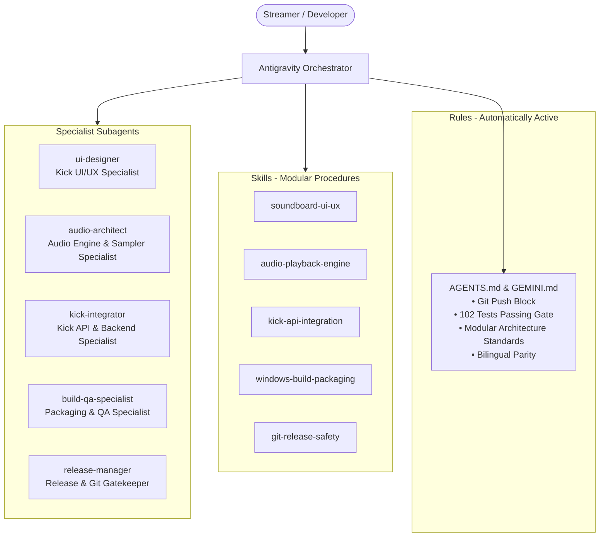

# Kick Soundboard - Agents, Skills & Rules Orchestration Guide

This guide explains how to use the custom rules, modular skills, and specialized subagents designed for the **Kick Soundboard** repository. You can use them individually for targeted tasks or combine them into powerful multi-agent workflows.

---

## 1. Architecture Overview



### The Three Layers
1. **Repository Rules (`AGENTS.md` / `GEMINI.md`)**: Always active in context. They prevent unauthorized Git pushes, enforce modular component architecture, require error logging to `logs/error.log`, and ensure all 102 tests pass before tasks finish.
2. **Modular Skills (`.agents/skills/*`)**: Focused, step-by-step procedural playbooks that can be activated on demand for specific subsystems.
3. **Specialist Subagents (`.agents/subagents/*`)**: Autonomous agent personas with tailored system prompts that focus exclusively on their domain.

---

## 2. Using Skills One by One

Skills provide targeted checklists, design tokens, and technical patterns. You can activate them simply by mentioning their name or asking a task in their domain:

| Skill | When to Use | Trigger Phrases | Key Files |
|---|---|---|---|
| **`soundboard-ui-ux`** | UI/UX redesigns, CSS styling, Sound Pad grid layout, SVG charts, privacy animations | "update styling", "modernize UI", "soundpad grid", "streamer mode blur", "SVG wave" | `src/css/*.css`, `src/js/components/soundpad.js`, `src/js/components/analytics.js` |
| **`audio-playback-engine`** | Audio retriggering, queueing, device routing, AbortError handling, volume curves | "audio retrigger", "sound queue", "sampler spam", "panic stop", "OBS audio routing" | `src/js/components/queue.js`, `src/js/components/soundpad.js`, `src/js/components/settings.js` |
| **`kick-api-integration`** | Kick API, OAuth 2.1 PKCE, polling backoff, username resolution, safeStorage | "kick oauth", "polling redemptions", "backoff delay", "resolve usernames", "token security" | `api/auth/*`, `src/polling-backoff.js`, `src/redemption-playback.js`, `src/user-resolver.js` |
| **`windows-build-packaging`** | Compiling Windows executable, NSIS installers, icons, smoke testing | "build windows", "package installer", "nsis build", "smoke test build" | `package.json`, `release/win-unpacked/`, `release/Kick-Soundboard-Setup-*.exe` |
| **`git-release-safety`** | Staging changes, version bumping, changelog updates, safe push gates | "prepare release", "bump version", "git status audit", "push approval" | `AGENTS.md`, `package.json`, `README.md` |

---

## 3. Using Subagents One by One

You can delegate specific tasks to individual subagents. Each subagent runs with its own focused prompt and reports back when finished:

### 1. `ui-designer` (Kick UI/UX Specialist)
- **Role**: Visual design, CSS modularization, 3D tactile buttons, animations, and bilingual layouts.
- **Example Prompt**:
  > *"Delegate to ui-designer: Make the Sound Pad buttons feel more responsive with a subtle glow on active playback, and ensure the change-sound button is styled in neon green."*

### 2. `audio-architect` (Audio Engine & Sampler Specialist)
- **Role**: Sampler retriggering (`currentTime = 0`), interrupting sounds without `AbortError`, volume attenuation, and OBS routing.
- **Example Prompt**:
  > *"Delegate to audio-architect: Inspect the audio queue to make sure rapid spam clicks on the same pad never spawn duplicate audio elements, and verify effective volume clamping."*

### 3. `kick-integrator` (Kick API & Backend Specialist)
- **Role**: Electron IPC, OAuth 2.1 PKCE flow, exponential polling backoff, username caching, and Windows DPAPI `safeStorage`.
- **Example Prompt**:
  > *"Delegate to kick-integrator: Check the polling engine backoff logic when Kick API returns a 429 rate limit, and verify tokens are encrypted using safeStorage."*

### 4. `build-qa-specialist` (Packaging & QA Specialist)
- **Role**: Automated test suite execution (102 tests), pass/fail edge cases, `electron-builder` NSIS compilation, and binary inspection.
- **Example Prompt**:
  > *"Delegate to build-qa-specialist: Run all 102 test cases with fail and pass scenarios, then build the Windows standalone binary and verify its size."*

### 5. `release-manager` (Release & Git Gatekeeper)
- **Role**: Auditing diffs, version bumping, and enforcing human confirmation before any git operations.
- **Example Prompt**:
  > *"Delegate to release-manager: Audit git status and prepare a changelog summary for version 0.2.3, but do NOT commit or push until I approve."*

---

## 4. Using Them Together (Multi-Agent Workflows)

Here is how multiple agents and skills collaborate on complex tasks:

### Workflow A: New Interactive Feature (UI + Audio + QA)
When adding a new interactive feature (e.g. A sound loop mode or custom volume per pad):
1. **Step 1 - UI Specialist**: `ui-designer` designs the UI toggle and adds modular styles into `src/css/soundpad.css`.
2. **Step 2 - Audio Specialist**: `audio-architect` implements the playback loop mechanics and volume calculations in `src/js/components/soundpad.js`.
3. **Step 3 - QA Specialist**: `build-qa-specialist` writes test scenarios in `test/ui-interactions-and-functions.test.js`, executes `pnpm test`, and packages the build.

### Workflow B: Kick API Expansion (Backend + UI + QA)
When adding support for Kick Subscriber Badges or Chat Triggers:
1. **Step 1 - API Specialist**: `kick-integrator` adds the API endpoints, updates the polling worker, and securely caches badges.
2. **Step 2 - UI Specialist**: `ui-designer` updates `src/js/components/studio.js` to render the badge next to usernames.
3. **Step 3 - QA Specialist**: `build-qa-specialist` runs all unit tests to guarantee 100% test pass rate.

### Workflow C: Preparing a Release (QA + Release Manager)
When ready to ship an update:
1. **Step 1 - QA Specialist**: Runs `pnpm test` (all 102 passing) and builds `pnpm build:win`.
2. **Step 2 - Release Manager**: Checks `git status`, synchronizes versions in `package.json` and `README.md`, and presents the diff summary to the user.
3. **Step 3 - Human Gate**: User inspects the unpacked binary in `release/win-unpacked/Kick Soundboard.exe` and types "approve" before any commit or push occurs.

---

## 5. Step-by-Step Developer Commands Reference

### Run the Full Test Suite
```powershell
pnpm test
```
*Expected: 102 passed, 0 failed.*

### Run the Desktop App in Development Mode
```powershell
pnpm start
```

### Build Standalone Windows Executable & Installer
```powershell
pnpm build:win
```
*Output files:*
- `release\win-unpacked\Kick Soundboard.exe` (Instant standalone app)
- `release\Kick-Soundboard-Setup-0.2.3.exe` (NSIS setup installer)

### Check Working Tree (Zero Push Policy)
```powershell
git status
```
*Always verify changes locally before asking the user for push confirmation.*
